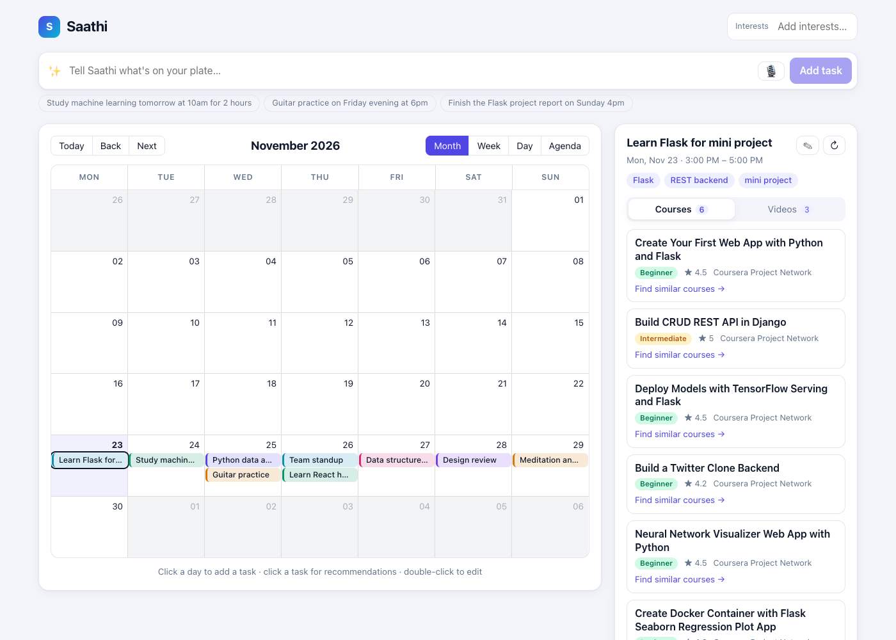
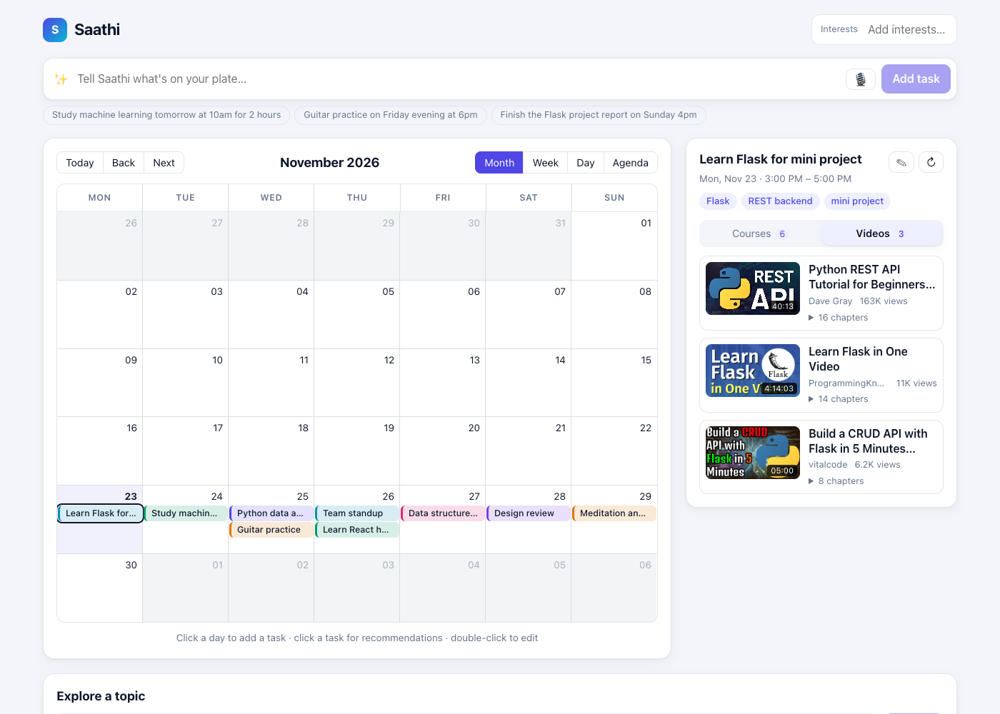
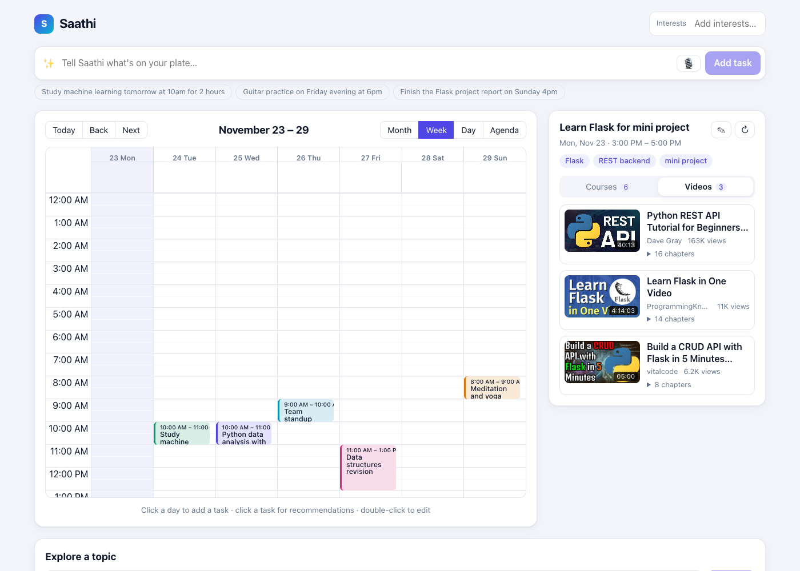
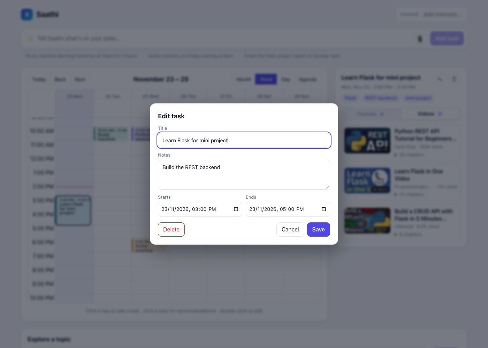
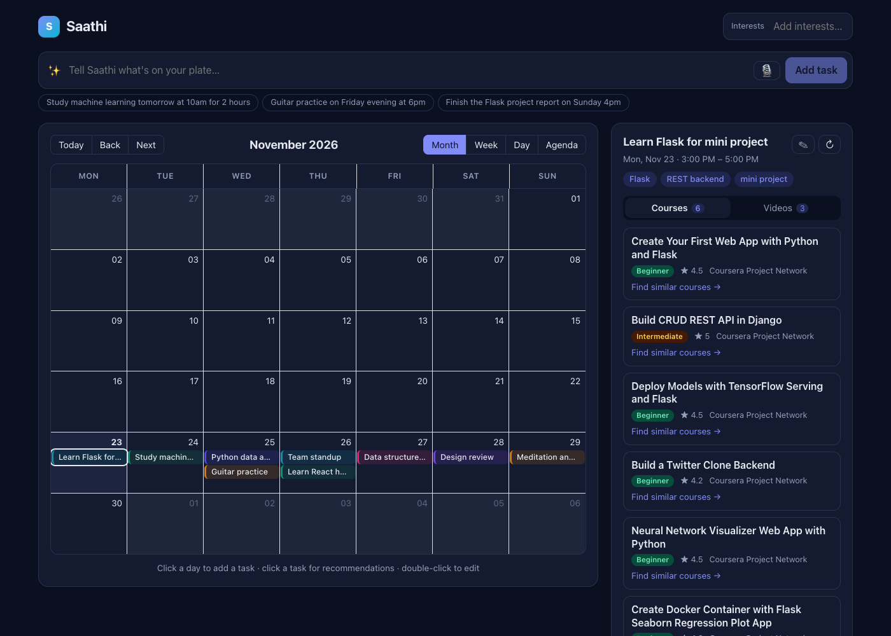
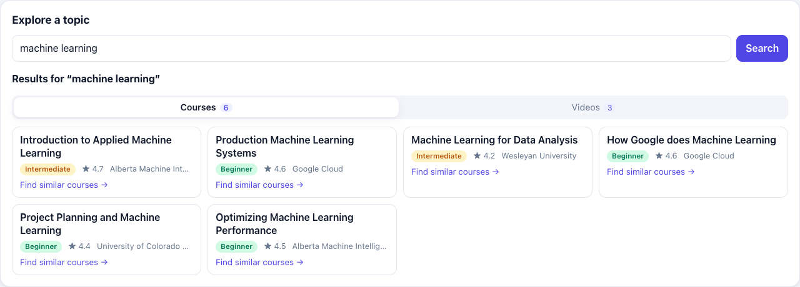
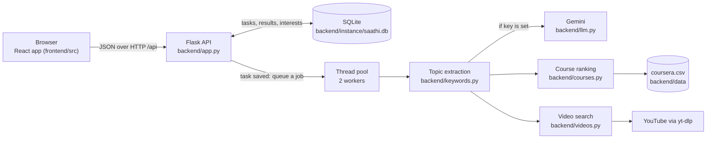
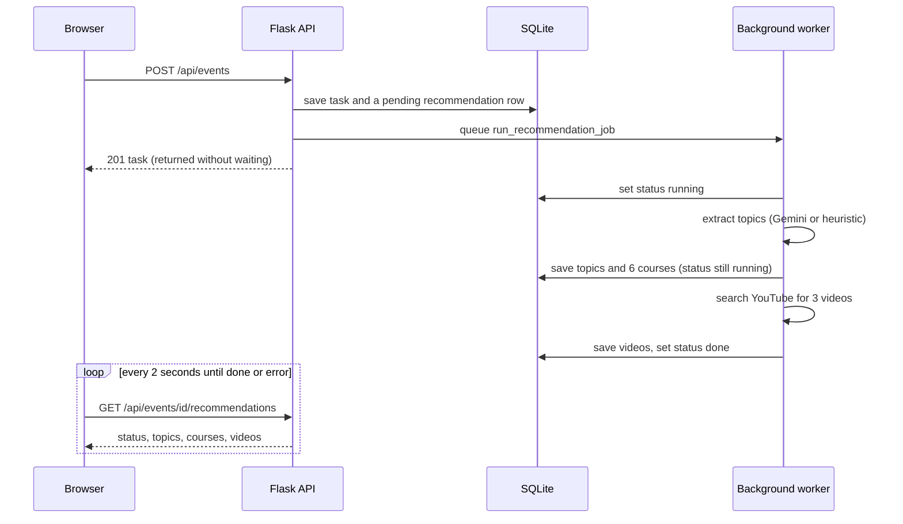

# Saathi

Saathi is a calendar app that suggests **Coursera courses** and **YouTube videos** for every task you schedule, so planning your week and finding something to learn happen in one place.



## Why it exists

Most to-do and calendar tools only store tasks. If a task says "Learn Flask for my mini project", you still have to leave the app, search for a course, and search for a video.

Saathi does that step for you:

1. You add a task, either with a form or by typing a plain sentence such as *"Study machine learning on Friday at 10am for an hour"*.
2. In the background it works out the **topic** of the task (for example `machine learning`).
3. It finds matching courses from a bundled list of Coursera courses and matching videos from YouTube, and shows them next to the calendar.

The project follows the paper *"Task Scheduling with Integrated Recommendation Systems and LLM"* (a task scheduler that combines a language model, a recommender, and `yt-dlp` for video). It implements the scheduler, the language-model input, the video suggestions and a **content-based** course recommender. It does **not** reproduce the paper's collaborative-filtering experiments; see [Differences from the paper](#differences-from-the-paper).

## Contents

- [Why it exists](#why-it-exists)
- [Screenshots](#screenshots)
- [Quick start](#quick-start)
- [Using the app](#using-the-app)
- [How it works](#how-it-works)
- [Project structure](#project-structure)
- [Configuration](#configuration)
- [API reference](#api-reference)
- [Data model](#data-model)
- [How the recommendations are chosen](#how-the-recommendations-are-chosen)
- [Design decisions](#design-decisions)
- [Deployment notes](#deployment-notes)
- [Testing](#testing)
- [Extending Saathi](#extending-saathi)
- [Limitations](#limitations)
- [Troubleshooting](#troubleshooting)
- [Differences from the paper](#differences-from-the-paper)
- [Glossary](#glossary)

## Screenshots

|                                                                                                                                                    |                                                                                                                                |
| -------------------------------------------------------------------------------------------------------------------------------------------------- | ------------------------------------------------------------------------------------------------------------------------------ |
|  **Videos tab.** Thumbnail, duration, channel, views and chapters for each suggested video. |  **Week view.** Month, week, day and agenda views; weeks start on Monday. |
|  **Edit window.** Double-click a task to change or delete it.                                 |  **Dark mode.** Follows the operating-system setting.                     |

**Explore a topic** searches courses and videos without creating a task:



The screenshots show sample tasks seeded for the week of 23 November 2026. They were captured from the running app.

## Quick start

### Prerequisites

| Tool             | Version                              | Why                                                                                                                                                                     |
| ---------------- | ------------------------------------ | ----------------------------------------------------------------------------------------------------------------------------------------------------------------------- |
| Python           | 3.11 (tested on 3.11.12)             | Runs the backend                                                                                                                                                        |
| Node.js and npm  | Tested on Node 23.7.0 and npm 10.9.2 | Builds the frontend. `backend/videos.py` also tells `yt-dlp` to use Node.js for YouTube's JavaScript checks; whether video search works without Node was not tested |
| Internet access  |                                      | Needed for video suggestions (YouTube) and, if enabled, Gemini                                                                                                          |
| A Gemini API key | Optional                             | Only for typing a sentence to create a task, and for smarter topic extraction. Everything else works without it                                                         |

Other Python or Node versions were not tested.

### Install

Run these from the project folder (the one that contains this README):

```bash
python3.11 -m venv .venv
.venv/bin/python -m pip install -r backend/requirements.txt
npm --prefix frontend ci
npm --prefix frontend run build
```

On Windows, use `.venv\Scripts\python` instead of `.venv/bin/python`. Windows was not tested.

### Run

```bash
.venv/bin/python backend/app.py
```

The first start takes a few seconds while Python loads its libraries. You should see:

```text
 * Serving Flask app 'app'
 * Debug mode: on
 * Running on http://127.0.0.1:5001
```

Open **http://127.0.0.1:5001**. On a fresh install the calendar is empty. Click any day, type a title such as `Learn Flask for my mini project`, and press **Save**. The side panel shows skeleton placeholders for a few seconds, then the extracted topics, six courses and three videos.

One Flask process serves both the web page and the API. There is nothing else to start.

### Optional: turn on Gemini (sentence input and smarter topics)

1. Create a key in [Google AI Studio](https://aistudio.google.com/).
2. Copy the example settings and add your key:

   ```bash
   cp .env.example .env
   ```

   Then edit `.env` and set `GEMINI_API_KEY=your-key`. The file is listed in `.gitignore`, so it is not committed.
3. Restart the server.

Now the command bar at the top accepts sentences like *"Guitar practice on Friday evening at 6pm"*. Without a key, that bar shows the error `Set GEMINI_API_KEY to use natural-language commands.` and topic extraction uses a simpler built-in method.

### Development mode (hot reload)

Use two terminals:

```bash
# Terminal 1: API on port 5001
.venv/bin/python backend/app.py

# Terminal 2: React dev server on port 3000
npm --prefix frontend start
```

Open **http://localhost:3000**. The dev server forwards `/api` requests to `http://127.0.0.1:5001` (set by `"proxy"` in [frontend/package.json](frontend/package.json)). Port 5001 is used because macOS reserves port 5000 for AirPlay.

## Using the app

| You want to                    | Do this                                                                                                             |
| ------------------------------ | ------------------------------------------------------------------------------------------------------------------- |
| Add a task                     | Click a day, fill in the form, **Save**                                                                       |
| Add a task from a sentence     | Type it in the top bar and press **Add task** (needs a Gemini key). Click an example under the bar to try one |
| Dictate a task                 | Click the microphone button. It appears only in browsers that support speech recognition                            |
| See recommendations            | Click a task. The next upcoming task is selected when the page opens                                                |
| Edit or delete a task          | Double-click it, or click the pencil icon in the side panel                                                         |
| Refresh recommendations        | Click the circular-arrow icon in the side panel                                                                     |
| Find courses like one you saw  | Click **Find similar courses** under a course. Results appear in the Explore section                          |
| Tune course results            | Add interests (for example `python`) in the header; they are saved and affect course ranking                      |
| Look up a topic without a task | Use **Explore a topic** at the bottom                                                                         |

Each task gets one of six colors, shown as a light tint with a colored stripe in the month, week, day and agenda views. Your tasks are saved in a local database file; see [Data model](#data-model).

## How it works

### The big picture



### What happens when you save a task

Saving a task never waits for YouTube. The API stores the task, hands the slow work to a background worker, and answers immediately. The browser then asks every 2 seconds for the result until it is ready.



Courses appear before videos because they are saved first. If YouTube fails, the courses still show and the panel says video suggestions are unavailable.

## Project structure

```text
Saathi/
├── README.md
├── .env.example            settings template (copy to .env)
├── .gitignore
├── backend/
│   ├── app.py              Flask app: routes, database models, background jobs
│   ├── courses.py          course recommender (TF-IDF)
│   ├── keywords.py         topic extraction (Gemini or fallback)
│   ├── llm.py              tiny Gemini client
│   ├── videos.py           YouTube search through yt-dlp
│   ├── requirements.txt    Python dependencies
│   ├── data/coursera.csv   3,522 Coursera courses
│   └── instance/           created on first run; holds saathi.db (not committed)
├── frontend/
│   ├── package.json        npm dependencies, scripts, dev proxy
│   ├── package-lock.json   exact dependency versions (used by npm ci)
│   ├── public/index.html   HTML shell
│   └── src/                React source (see below)
└── docs/screenshots/       images used in this README
```

These are created locally and git-ignored: `.venv/` (Python environment), `frontend/node_modules/`, `frontend/build/` (the built web page that Flask serves), and `.env`.

### Backend

| File                                                  | Role and how it works                                                                                                                                                                                                                                                                                                                                            |
| ----------------------------------------------------- | ---------------------------------------------------------------------------------------------------------------------------------------------------------------------------------------------------------------------------------------------------------------------------------------------------------------------------------------------------------------- |
| [backend/app.py](backend/app.py)                       | The center of the app. Defines the three database tables (`Event`, `Recommendation`, `Profile`), validates input, exposes the `/api/...` routes, owns the 2-worker thread pool, and serves the built frontend from `frontend/build`. On startup it creates the tables and marks any job left `pending` or `running` by a previous run as `error` |
| [backend/courses.py](backend/courses.py)               | Loads `coursera.csv` once, builds a TF-IDF matrix, and answers two questions: "which courses match these words?" (`search`) and "which courses look like this one?" (`similar`). See [How the recommendations are chosen](#how-the-recommendations-are-chosen)                                                                                              |
| [backend/keywords.py](backend/keywords.py)             | Turns a task title and notes into up to 4 topic words. Asks Gemini when a key is set; otherwise (or if Gemini fails) strips filler words and takes the first remaining words                                                                                                                                                                                     |
| [backend/llm.py](backend/llm.py)                       | Sends one request to Gemini's `generateContent` endpoint using only Python's standard library and returns the reply parsed as JSON. Retries once after 3 seconds on HTTP 429 or 503                                                                                                                                                                            |
| [backend/videos.py](backend/videos.py)                 | Runs `ytsearch<N>:<query>` through the `yt_dlp` Python library and keeps title, channel, view count, duration, thumbnail, URL and chapters. Results for a query are cached in memory (up to 128 queries)                                                                                                                                                     |
| [backend/data/coursera.csv](backend/data/coursera.csv) | The course list read by `courses.py`. Columns: Course Name, University, Difficulty Level, Course Rating, Course URL, Course Description, Skills                                                                                                                                                                                                                |
| [backend/requirements.txt](backend/requirements.txt)   | Flask, Flask-SQLAlchemy, Flask-CORS, python-dotenv, pandas, numpy, scikit-learn, yt-dlp, gunicorn                                                                                                                                                                                                                                                                |

### Frontend (`frontend/src`)

| File                                                                       | Role and how it works                                                                                                                                                                                                                                   |
| -------------------------------------------------------------------------- | ------------------------------------------------------------------------------------------------------------------------------------------------------------------------------------------------------------------------------------------------------- |
| [index.js](frontend/src/index.js)                                           | Mounts `<App />` into the page                                                                                                                                                                                                                        |
| [App.js](frontend/src/App.js)                                               | The page. Holds all state (tasks, selected task, recommendations, interests, explore results), draws the calendar, polls for recommendations while a job is `pending` or `running`, and picks the next upcoming task on load. Weeks start on Monday |
| [api.js](frontend/src/api.js)                                               | One function per API route. Turns network failures and error responses into readable messages                                                                                                                                                           |
| [components/CommandBar.js](frontend/src/components/CommandBar.js)           | The sentence box, example chips, and the microphone button (browser speech recognition, shown only where supported)                                                                                                                                     |
| [components/EventModal.js](frontend/src/components/EventModal.js)           | The new/edit task window. Checks title and that the end is after the start before sending                                                                                                                                                               |
| [components/Recommendations.js](frontend/src/components/Recommendations.js) | The side panel and the shared course list, video list, tabs and loading skeleton                                                                                                                                                                        |
| [components/InterestsEditor.js](frontend/src/components/InterestsEditor.js) | Interest tags: Enter or comma adds, × removes. Saves on every change                                                                                                                                                                                   |
| [App.css](frontend/src/App.css), [index.css](frontend/src/index.css)         | Styling, including light and dark colors and overrides for the calendar library                                                                                                                                                                         |
| [App.test.js](frontend/src/App.test.js)                                     | Four tests, see [Testing](#testing)                                                                                                                                                                                                                      |

Main libraries: React 18, [react-big-calendar](https://github.com/jquense/react-big-calendar) for the calendar, and moment for dates. `react-scripts` 5 (Create React App) builds it.

## Configuration

Settings are read from environment variables. `backend/app.py` also loads a `.env` file in the project root.

| Variable           | Default                                            | Meaning                                                                                                                                                                                                           |
| ------------------ | -------------------------------------------------- | ----------------------------------------------------------------------------------------------------------------------------------------------------------------------------------------------------------------- |
| `GEMINI_API_KEY` | none                                               | Enables sentence input and Gemini topic extraction. Leave empty to disable                                                                                                                                        |
| `GEMINI_MODEL`   | `gemini-flash-lite-latest`                       | Which Gemini model to call. Flash Lite models showed higher free-tier limits than the full Flash model in Google AI Studio (see [Limitations](#limitations)); this matters because each task uses one or two calls |
| `API_PORT`       | `5001`                                           | Port for `python backend/app.py`. If you change it, also change `"proxy"` in `frontend/package.json` for development mode                                                                                   |
| `DATABASE_URL`   | `sqlite:///<project>/backend/instance/saathi.db` | Any SQLAlchemy URL. Only SQLite was tested                                                                                                                                                                        |

Fixed in code (change the source to alter them):

| Value                             | Where                                      | Setting                                       |
| --------------------------------- | ------------------------------------------ | --------------------------------------------- |
| Courses per task / per search     | `backend/app.py`, `backend/courses.py` | 6                                             |
| Videos per task / per search      | `backend/app.py`                         | 3                                             |
| Topics per task                   | `backend/keywords.py`                    | up to 4                                       |
| Background workers                | `backend/app.py`                         | 2                                             |
| Interest weight in course ranking | `backend/courses.py`                     | 0.3                                           |
| Browser polling interval          | `frontend/src/App.js`                    | 2 seconds                                     |
| Gemini request timeout            | `backend/llm.py`                         | 30 seconds                                    |
| Limits on input                   | `backend/app.py`                         | title 100 characters, notes 255, interests 20 |

## API reference

All routes are under `http://127.0.0.1:5001`. Request and response bodies are JSON. Errors have the shape `{"error": "message"}`.

| Method and path                                     | Purpose                                                                   | Success                                                 | Errors                                                                                                              |
| --------------------------------------------------- | ------------------------------------------------------------------------- | ------------------------------------------------------- | ------------------------------------------------------------------------------------------------------------------- |
| `GET /api/events`                                 | List all tasks, in the order they were created                            | `200` array of tasks                                  |                                                                                                                     |
| `POST /api/events`                                | Create a task and queue recommendations                                   | `201` task                                            | `400` invalid input                                                                                               |
| `PUT /api/events/<id>`                            | Replace a task. Queues new recommendations only if title or notes changed | `200` task                                            | `400` invalid input, `404` unknown id                                                                           |
| `DELETE /api/events/<id>`                         | Delete a task and its recommendations                                     | `200` `{"deleted": id}`                             | `404` unknown id                                                                                                  |
| `POST /api/process_command`                       | Turn `{"command": "<sentence>"}` into one task using Gemini             | `201` task                                            | `400` empty command, `422` Gemini's answer was not a valid task, `502` Gemini call failed, `503` no API key |
| `GET /api/events/<id>/recommendations`            | Topics, courses and videos for a task                                     | `200` recommendation                                  | `404` unknown id                                                                                                  |
| `POST /api/events/<id>/recommendations`           | Same, but first queues a fresh job                                        | `200` recommendation (status is normally `pending`) | `404` unknown id                                                                                                  |
| `GET /api/courses?q=<text>`                       | Top 6 courses for some words, using saved interests                       | `200` array of courses                                | `400` empty `q`                                                                                                 |
| `GET /api/courses?similar_to=<exact course name>` | 6 courses most similar to that course                                     | `200` array (empty if the name is unknown)            |                                                                                                                     |
| `GET /api/videos?q=<text>`                        | Top 3 YouTube videos (live search)                                        | `200` array of videos                                 | `400` empty `q`, `502` search failed                                                                          |
| `GET /api/profile`                                | Saved interests                                                           | `200` `{"interests": [...]}`                        |                                                                                                                     |
| `PUT /api/profile`                                | Replace interests with `{"interests": ["python", ...]}`                 | `200` same shape                                      | `400` not a list of strings                                                                                       |

**Task** (input and output)

```json
{
  "id": 1,
  "title": "Learn Flask for my mini project",
  "start": "2026-11-25T10:00:00+05:30",
  "end": "2026-11-25T11:00:00+05:30",
  "desc": "Build the REST backend"
}
```

`start` and `end` must be ISO 8601 date-times with the same timezone style, and `end` must be after `start`. `desc` is optional.

**Recommendation**

```json
{
  "event_id": 1,
  "status": "done",
  "keywords": ["flask"],
  "courses": [{"name": "Create Your First Web App with Python and Flask", "university": "Coursera Project Network",
               "level": "Beginner", "rating": "4.5", "url": "https://www.coursera.org/learn/python-flask", "score": 0.3619}],
  "videos": [{"title": "Learn Flask for Python - Full Tutorial", "channel": "freeCodeCamp.org", "views": 2346776,
              "duration": "0:46:59", "url": "https://www.youtube.com/watch?v=Z1RJmh_OqeA",
              "thumbnail": "https://i.ytimg.com/...", "chapters": ["1. Introduction", "..."]}],
  "error": ""
}
```

`status` moves through `pending` → `running` → `done`, or ends as `error`. `error` can be non-empty even when `status` is `done` (for example, videos failed but courses worked).

Example calls:

```bash
curl http://127.0.0.1:5001/api/events
curl -X POST http://127.0.0.1:5001/api/events -H 'Content-Type: application/json' \
  -d '{"title":"Study machine learning","start":"2026-11-26T09:00:00Z","end":"2026-11-26T10:00:00Z"}'
curl "http://127.0.0.1:5001/api/courses?q=machine%20learning"
```

## Data model

SQLite, created automatically by Flask-SQLAlchemy on first run.

**Where your tasks live:** every task you add is saved to the file `backend/instance/saathi.db`, so tasks survive restarts. The file is in `.gitignore`, so it is not uploaded to GitHub and a fresh clone starts with an empty calendar. To back it up, copy the file while the server is stopped. To start over, stop the server and delete the file; it is recreated empty on the next start. Set `DATABASE_URL` to keep it somewhere else.

| Table              | Columns                                                                                                               | Notes                                                             |
| ------------------ | --------------------------------------------------------------------------------------------------------------------- | ----------------------------------------------------------------- |
| `event`          | `id`, `title` (max 100), `start`, `end` (text, ISO 8601), `desc` (max 255)                                  | Times are stored exactly as sent, as text                         |
| `recommendation` | `event_id` (primary key and foreign key to `event`), `status`, `keywords`, `courses`, `videos`, `error` | One row per task. The three result columns hold JSON text         |
| `profile`        | `id`, `interests` (JSON list as text)                                                                             | A single row with `id = 1`, created the first time it is needed |

The course list is **not** in the database. It is read from `backend/data/coursera.csv` into memory: 3,522 rows, of which **3,424** remain after removing rows with a duplicate Course URL. Difficulty levels in the data: Beginner 1,406, Advanced 991, Intermediate 823, Conversant 154, Not Calibrated 50.

## How the recommendations are chosen

### 1. Finding the topic ([backend/keywords.py](backend/keywords.py))

- **With a Gemini key:** the title and notes are sent to Gemini with the instruction to return up to 4 short, studyable topics as JSON.
- **Without a key, or if Gemini fails:** the title and notes are split into words; common words (such as "the"), weekday names and filler like "learn", "project" and "meeting" are dropped; the first 4 remaining distinct words are kept. For `Learn Flask for my mini project` this gives `["flask"]`.

### 2. Ranking courses ([backend/courses.py](backend/courses.py))

Each course becomes a text made of its **name three times**, its **skills twice**, and its **description once**, so title and skill matches count most. The text is turned into **TF-IDF** vectors (English stop words removed; words in fewer than 2 courses ignored; the vocabulary has 11,545 terms). The topic words get the same treatment, and courses are ranked by **cosine similarity** to the topic words.

If you saved interests, the ranking score is `similarity(topic) + 0.3 × similarity(interests)`. Only courses with a score above zero are returned, so you can get fewer than 6. "Find similar courses" ranks every other course against the chosen course in the same way.

### 3. Finding videos ([backend/videos.py](backend/videos.py))

The topic words are joined into a search phrase and sent to YouTube through `yt-dlp` (`ytsearch3:<phrase>`). Results come back in YouTube's own order; Saathi does no ranking of its own.

## Design decisions

| Decision                                              | Reason                                                                                                                                                                                           |
| ----------------------------------------------------- | ------------------------------------------------------------------------------------------------------------------------------------------------------------------------------------------------ |
| Background job queue, polled by the browser           | A YouTube lookup takes several seconds. Saving a task must feel instant                                                                                                                          |
| `ThreadPoolExecutor` instead of Celery or Redis     | A single-user local app needs no separate queue service. Trade-off: queued jobs live in memory and do not survive a restart (they are marked `error` on the next start and can be regenerated) |
| SQLite                                                | No database server to install. Fine for one user                                                                                                                                                 |
| TF-IDF over a CSV instead of a trained model          | No training step, the index builds in about 0.4 seconds on the author's laptop, and a match can be explained from the words                                                                      |
| Course data in memory, not in the database            | It never changes at runtime                                                                                                                                                                      |
| Gemini over plain HTTP (`llm.py`) instead of an SDK | One small standard-library file, one fewer dependency                                                                                                                                            |
| Gemini is optional                                    | The app is fully usable for tasks, courses and videos without any key or account                                                                                                                 |
| Flash Lite as the default model                       | In AI Studio the full Flash model showed 5 requests per minute and 20 per day on the free tier, which a handful of tasks would use up; Flash Lite showed 15 per minute and 500 per day           |
| One Flask process serves the built frontend           | One command to run; no CORS or two-server setup for normal use                                                                                                                                   |

## Deployment notes

Saathi is built to run on your own machine. If you want to host it:

- **`python backend/app.py` runs Flask in debug mode**, which includes an interactive debugger. Never expose it to a network. For anything shared, use gunicorn instead. This works (tested):

  ```bash
  .venv/bin/gunicorn --chdir backend --workers 1 --bind 127.0.0.1:5001 app:app
  ```

  Keep `--workers 1`. Each worker marks unfinished jobs as failed when it starts and has its own in-memory job queue, so more workers would interfere with each other.
- **There is no login.** Anyone who can reach the server can read and change all tasks and interests, and can spend your Gemini quota. Cross-origin requests are allowed from any origin (`CORS(app)`).
- Keep `.env` private. It holds your API key.

## Testing

```bash
CI=true npm --prefix frontend test -- --watchAll=false
```

Four tests, all passing on a clean install:

| Test               | What it checks                                                                                         |
| ------------------ | ------------------------------------------------------------------------------------------------------ |
| Empty panel        | Asks you to pick a task when none is selected                                                          |
| Courses and videos | Course links render; the Videos tab shows video links                                                  |
| Loading state      | A running job shows a loading placeholder                                                              |
| Whole app          | With a mocked API, the page loads, selects the upcoming task, and shows its courses and your interests |

The backend has **no automated tests**. It was checked by hand against a clean install: creating, validating and deleting tasks, the no-key and Gemini paths, and the error codes listed above. A production build of the frontend is made by `npm --prefix frontend run build`.

## Extending Saathi

| Goal                                                     | Edit                                                                                                                                                                                            |
| -------------------------------------------------------- | ----------------------------------------------------------------------------------------------------------------------------------------------------------------------------------------------- |
| Change how many courses or videos appear                 | `search(query, 6, ...)` and `search_videos(query, 3)` in `run_recommendation_job` in [backend/app.py](backend/app.py), and the matching calls in the `courses()` and `videos()` routes |
| Change course ranking (weights, fields)                  | `CourseIndex.__init__` and `search` in [backend/courses.py](backend/courses.py)                                                                                                              |
| Use a different course list                              | Replace [backend/data/coursera.csv](backend/data/coursera.csv), keeping the same column names, or update the column names used in `courses.py`                                                 |
| Improve the fallback topic extraction                    | `STOPWORDS` and `heuristic_keywords` in [backend/keywords.py](backend/keywords.py)                                                                                                           |
| Change the prompt Gemini sees                            | The prompt in `extract_keywords` ([backend/keywords.py](backend/keywords.py)) and in `process_command` ([backend/app.py](backend/app.py))                                                     |
| Use another LLM provider                                 | Replace the body of `generate_json` in [backend/llm.py](backend/llm.py); callers only need a function that returns a dict                                                                      |
| Add a new kind of recommendation (for example, articles) | Add a module like `videos.py`, call it in `run_recommendation_job`, add a column to `Recommendation`, and add a tab in [Recommendations.js](frontend/src/components/Recommendations.js)    |
| Change task colors | The `COLORS` list at the top of [frontend/src/App.js](frontend/src/App.js). Each task takes one color by its id, shown as a light tint with a colored left stripe; the tint rules are `.rbc-event.evt` and `.rbc-agenda-view tr.evt` in [frontend/src/App.css](frontend/src/App.css) |
| Change other colors or layout                                  | CSS variables at the top of [frontend/src/index.css](frontend/src/index.css); layout rules in [frontend/src/App.css](frontend/src/App.css)                                                        |

The API is read by the page through [frontend/src/api.js](frontend/src/api.js), so a new route needs a new function there too. Existing databases are not migrated: adding a column means deleting `backend/instance/saathi.db` (which loses your tasks) or altering the table yourself.

## Limitations

- **Single user, no login.** One shared profile of interests.
- **Course recommendations are content-based only.** Saathi has no ratings or user behavior data, so it cannot learn what you liked.
- **The course list is a fixed snapshot.** Its source and date are not recorded in this repository, and the Coursera links may have changed since. Saathi does not check them.
- **Video suggestions depend on YouTube and `yt-dlp`.** YouTube changes often; if `yt-dlp` falls behind, searches can fail. Upgrade with `.venv/bin/python -m pip install -U yt-dlp`.
- **Topic extraction is shallow without Gemini.** It keeps the first few non-filler words, so a task such as `Meeting with John` gives `["john"]`. It does not understand meaning.
- **Gemini free-tier limits apply.** The Google AI Studio rate-limit page on 2026-11-23 listed Flash Lite models at 15 requests per minute and 500 per day, and a full Flash model (which the `gemini-flash-latest` alias appeared to point to) at 5 per minute and 20 per day. Which model each alias maps to is Google's choice and can change, as can the limits. If you exceed them, the command bar reports an error and topic extraction falls back to the simple method.
- **In-memory job queue.** Jobs do not survive a restart.
- **Times are stored as text exactly as sent.** The web page sends UTC and displays your local time. Tasks created by sentence use the timezone Gemini returns, based on the server's clock and local offset.
- **No database migrations.** See [Extending Saathi](#extending-saathi).
- **No license file** is included in this repository, so no reuse permissions are granted by default.
- **Tested on macOS with Chrome only.** Other platforms and browsers were not tested.

## Troubleshooting

| Symptom                                                                        | Cause and fix                                                                                                                                                                                       |
| ------------------------------------------------------------------------------ | --------------------------------------------------------------------------------------------------------------------------------------------------------------------------------------------------- |
| `npm ci` says the lock file and `package.json` are out of sync             | Use the `package.json` and `package-lock.json` from this repository unchanged. (An earlier lock file pinned TypeScript 7, which Create React App does not support; the current one pins 4.9.5.) |
| `Address already in use` on port 5001                                        | Another copy is running. Stop it, or set `API_PORT` to another port and open that port                                                                                                            |
| The page says `Cannot reach the Saathi API`                                  | The Flask server is not running, or in development mode it is not on port 5001                                                                                                                      |
| Visiting `/` returns `Not found. For development run the React app`        | The frontend has not been built. Run `npm --prefix frontend run build`, or use development mode                                                                                                   |
| Command bar says `Set GEMINI_API_KEY...`                                     | No key is set. See [Optional: turn on Gemini](#optional-turn-on-gemini-sentence-input-and-smarter-topics). Restart the server after editing `.env`                                                 |
| Command bar says `Could not process the command.`                            | Gemini failed (busy, rate-limited, bad key or no internet). The server log has the details. Try again, or add the task with the form                                                                |
| Command bar shows a validation message (for example about `end`)             | Gemini's answer was not a valid task. Rephrase with an explicit time and duration                                                                                                                   |
| Courses appear but videos say `Video suggestions are unavailable right now.` | YouTube or `yt-dlp` failed, or there is no internet. Update `yt-dlp` (see Limitations), then click the refresh icon                                                                             |
| A task shows `Interrupted; press refresh to regenerate.`                     | The server was stopped while it was working on that task. Click the refresh icon                                                                                                                    |
| Recommendations stay on placeholders for a long time                           | The job is waiting for YouTube or Gemini (each can take several seconds). If it never finishes, check the terminal running the server                                                               |
| The first start is slow                                                        | The first run in a new environment compiles Python libraries. Later starts are faster                                                                                                               |
| Microphone button missing                                                      | Your browser does not support speech recognition. Type the sentence instead                                                                                                                         |

## Differences from the paper

The paper evaluates three **collaborative-filtering** methods (K-Nearest Neighbors, Singular Value Decomposition and Co-Clustering, using the Surprise library) on a Coursera **reviews** dataset, and reports error and precision figures for them. That dataset and those experiments are **not part of this repository**, so none of the paper's numbers are reproduced or claimed here.

| Paper                                                             | This project                                                        |
| ----------------------------------------------------------------- | ------------------------------------------------------------------- |
| Collaborative filtering (KNN, SVD, co-clustering) on user ratings | Content-based matching on course text (TF-IDF). It needs no ratings |
| User login with preferences and hobbies                           | No login. One saved list of interests                               |
| Word embeddings and "multimodal learning" for task understanding  | Gemini, or a simple word filter                                     |
| Task queue with multiple runners                                  | An in-process thread pool with 2 workers                            |
| Task management with a calendar, LLM input, yt-dlp videos         | Implemented (calendar, Gemini sentence input, yt-dlp video search)  |

## Glossary

| Term                                   | Meaning                                                                                                                            |
| -------------------------------------- | ---------------------------------------------------------------------------------------------------------------------------------- |
| **LLM**                          | Large language model, an AI that reads and writes text. Saathi uses Google's Gemini                                                |
| **TF-IDF**                       | A way to turn text into numbers. A word scores high in a document if it is frequent there but rare across all documents            |
| **Cosine similarity**            | A score from 0 to 1 for how alike two TF-IDF vectors are. Higher means more similar                                                |
| **Content-based recommendation** | Suggesting items because their *content* matches, as opposed to *collaborative* filtering, which uses what similar users liked |
| **yt-dlp**                       | An open-source tool that reads YouTube pages and returns video details                                                             |
| **Background job / queue**       | Work done after the response is sent, so the page stays responsive                                                                 |
| **Heuristic**                    | A simple rule of thumb used when a smarter method (here, Gemini) is unavailable                                                    |
| **SQLite**                       | A database that lives in one file, with no server                                                                                  |
